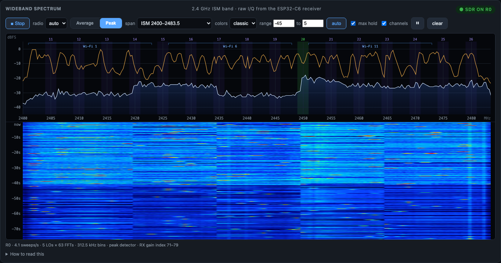

# RF spectrum & interference analysis

> Status: two complementary tools on the **RF spectrum** tab.
> **Wideband spectrum (SDR)** — raw I/Q from the C6's 2.4 GHz receiver, the whole ISM band as a
> trace + waterfall (firmware ≥ 0.34, tethered and satellite radios; *new — first hardware
> results and known issues below*). **Channel energy (ED)** — the 802.15.4 energy-detect sweep of channels 11–26,
> available on every radio (`core/ed_scan.c`, `ED_RESULT`).

## Wideband spectrum (SDR)



The ESP32-C6's Wi-Fi modem contains an undocumented **sample-dump engine** that writes the
receiver's raw ADC output — signed 10-bit I and Q at **80 MS/s** — into on-chip SRAM. That turns
the radio into a (low duty cycle) software-defined receiver: instead of "how much energy is on
channel 15", you see the actual shape of everything in the band — Wi-Fi's 20 MHz OFDM humps,
BLE's 2 MHz hops, Zigbee bursts, a microwave oven's sweeping magnetron, clock spurs.

The existence of this path, its registers and sample format were published by the
[ESPARGOS project (ESP-SDR)](https://espargos.net/espsdr/) — see also h0m3us3r's
[eSpDR](https://github.com/h0m3us3r/eSpDR) for the ESP32-S3 + FPGA streaming variant. This
project's implementation (`firmware/src/core/sdr_*.c`) is independent and MIT-licensed; no
ESPARGOS (GPL-3.0) code is included.

### How a sweep works

```
for each LO in 2412, 2427, 2442, 2457, 2472 MHz:      (Wi-Fi channel centers, 15 MHz apart)
    retune the PHY, settle 2 ms
    snapshot 16 128 complex samples (~200 µs) into the reserved SRAM bank
    63 × 256-point FFT on-chip: per-block DC removal, Hann window, fixed-point (no FPU)
    reduce to one 256-bin power spectrum (mean, or peak-hold) → SDR_SPECTRUM message (~280 B)
host: stitch the 5 segments onto one 312.5 kHz grid → trace + waterfall row
```

Each segment spans ±40 MHz around its LO, but only the middle is used: for every frequency the
host takes the bin from the **nearest** LO (so it's always within ±7.5 MHz of a center, well
inside the analog filter's flat region), and bridges the 3-bin DC notch at each LO by
interpolation. On hardware a sweep takes ~190 ms (≈4 sweeps/s) on a tethered radio — slower than
the ~10/s estimated from FFT cost alone; where the time goes hasn't been profiled yet (retune +
settle and the PHY channel routine are the suspects). Satellites are paced to one sweep per
250 ms, so their 200 kHz SPI link keeps up.

### Reading it

- **Levels are dBFS at the ADC**, with the radio's automatic gain control active. Compare
  signals *within* a sweep (and the gain index shown in the footer); don't read them as calibrated
  dBm. With no strong signal the AGC turns the gain up until thermal noise fills the ADC, so the
  floor sits around **−30 to −40 dBFS**, not −90. "⚠ ADC clipping" means something nearby is
  strong enough to saturate the receiver.
- **Duty cycle is ~1 %** (≈1 ms of RF per 100 ms sweep), so bursty signals are *sampled*, not
  continuously watched: a Wi-Fi frame or BLE packet shows as speckle in the waterfall. **Peak**
  (peak-hold within each snapshot) plus **max hold** (across sweeps) catches them; **Average**
  shows steady occupancy.
- **Seams at 2419.5 / 2434.5 / 2449.5 / 2464.5 MHz.** Segments are captured ~40 ms apart, so a
  burst can appear in one LO's slice and not the next — and the AGC picks a different gain for
  each snapshot, so the floor steps by a few dB at each boundary (see known issues).
- Overlays: Zigbee 11–26 shaded (your channel green), Wi-Fi 1/6/11 bracketed; hover for the
  frequency, level, and which Zigbee/Wi-Fi/BLE channels sit there.

### Which radio does it

Starting the SDR **takes the whole radio**: its 802.15.4 driver is suspended (start/stop/channel
changes are remembered and applied when it returns) and the Wi-Fi PHY is brought up receive-only.
Stopping hands it back. So with one radio you trade capture for a spectrum view; with a satellite
give it the **`sdr`** role (Config → Radios) and it sweeps continuously *at its location* while
the primary keeps capturing. The **standalone** build can't run it (its Wi-Fi AP uses the same
PHY), and firmware < 0.34 doesn't advertise it (`STATUS.caps`).

Cost: the firmware reserves SRAM bank 2 (128 KiB, 0x40840000–0x4085FFFF) from the heap for the
I/Q buffer on tethered and satellite builds, and links the Wi-Fi stack (only initialized while
the SDR runs).

### Hardware results (first bring-up, 2026-10-11)

Tethered ESP32-C6 (SuperMini, firmware 0.34) plus three SPI satellites:

| Check | Result |
|-------|--------|
| SDR capability advertised (`STATUS.caps`) | ✅ all four radios |
| Captures complete (no failed / short snapshots) | ✅ every LO, every sweep |
| Frequencies correct, I/Q not swapped | ✅ sharpest peaks at **2402 / 2426 / 2480 MHz** — BLE advertising channels 37/38/39; a mirrored spectrum would put the 2402 peak at 2422 |
| Real signals | ✅ BLE advertising (a steady line at 2480 MHz in the waterfall), BLE connection hops (narrow speckle), a Wi-Fi hump around 2435–2442 MHz |
| Sweep rate | ⚠ ~4.1/s tethered (190 ms per sweep), not ~10/s |
| Satellite SDR | ✅ after the host + primary fixes below — sweeps arrive at 4/s, none dropped |
| 802.15.4 capture resumes after **Stop** | ⏳ not yet confirmed |

### Known issues

- **AGC seams and floor.** The AGC re-ranges per snapshot (gain index 65–79 seen in a quiet band,
  and occasional readings up to ~190 alongside "ADC clipping" that look like AGC state rather than
  gain). Fix planned: hold the RX gain fixed for the duration of a sweep, which flattens the seams
  and makes levels comparable across the band and over time.
- **A tethered radio wedged after ~4½ minutes of continuous SDR** (first bring-up). It reset
  (USB re-enumerated), then sent nothing at all — no STATUS heartbeat — even after further
  resets, until it was re-flashed. Cause not yet found: the SuperMini's UART console isn't wired to
  USB, so there were no logs, and the bundled OpenOCD predates C6 support. If it happens, re-flash
  (`pio run -e tethered -t upload`); if that doesn't bring it back, erase first
  (`-t erase`, which also clears the radio's saved channel and key).
- **One-shot ED scans relayed to a satellite** returned only 3 of 16 channel results once —
  not yet investigated.

### Satellite fixes made during bring-up

- **Spectrum showed under the wrong radio.** The primary re-stamped a satellite's `radio_id` by
  SPI slot only on captured frames and STATUS; SDR segments (and ED/probe results) kept the
  satellite's stored id — default 1 on every satellite — so slot 3's sweeps appeared as radio 1's.
  The primary now overrides `radio_id` by slot on all of them (re-flash the **primary**; satellites
  are unaffected).
- **SDR start never reached a satellite.** Two commands relayed to the same satellite back to back
  lost the second (the satellite's SPI slave hadn't re-armed yet), so the SDR start's mode change
  after its config frame was dropped. The host now spaces relayed commands 25 ms apart
  (`api.SatRelayGap`).

### Bring-up checklist (any new board)

1. *RF spectrum → Wideband spectrum*: the radio list should offer the radio (not "— no SDR");
   press **Start**. An "SDR unavailable: …" device log line means `sdr_capture_begin()` failed
   (reason included).
2. Footer shows sweeps/s with 0 failed LOs. Failed LOs = the dump engine timed out or wrote short
   (`sdr_capture_snapshot()`).
3. Sanity: peaks at 2402 / 2426 / 2480 MHz (BLE advertising) are the quickest check; a phone
   streaming on your Wi-Fi shows a ~20 MHz hump. Signal mirrored around an LO would mean I/Q are
   swapped — swap `sdr_sample_i`/`sdr_sample_q`.
4. **Stop**, then confirm 802.15.4 capture resumes (frames flowing on your channel). This
   PHY hand-back (`radio_capture_resume()`) is the least-proven step.
5. On a satellite, select it in the radio list (or give it the `sdr` role) and check its traces
   arrive under its own radio number.

Tunables if needed: `SDR_SETTLE_US` (sdr_capture.c), the LO plan and interval
(`/api/sdr/start?los=&interval=`), and `DefaultUsableHalfMHz` (tether `internal/sdr`).

## Channel energy (802.15.4 ED)

### How it works

The 802.15.4 radio can measure **energy on a channel** without decoding anything
(`esp_ieee802154_energy_detect()`). Sweeping channels 11–26 and sampling each repeatedly builds
a **noise-floor profile** over time — this is our spectrum analyzer. It does not identify the
*source* directly (it's energy, not a demodulated signal), but combined with the
[Wi-Fi overlap table](channels-reference.md) it strongly implicates sources.

### What you get

- **Per-channel noise floor** (dBm) and a **waterfall** (channel × time × energy heatmap).
- **Wi-Fi overlap overlay** — map raised energy to the Wi-Fi channels that sit on it.
- **Channel advisor** — recommend the quietest Zigbee channel clear of your busy Wi-Fi channels
  (typically 15 / 20 / 25), with a caution that *moving* a Zigbee network forces all devices to
  re-join.
- **Correlation with incidents** — capture the channel energy at the moment a device dropped
  (see [incidents.md](incidents.md)) to test the "interference caused the drop" hypothesis.

### Single-radio compromise vs. satellites

One radio can either capture **or** measure energy at any instant. The `CAPTURE_PLUS_ED` mode
interleaves them (you miss some frames during ED). A **second radio** removes the tradeoff: pin
radio A to the HA channel for continuous capture while radio B sweeps. That second radio can be a
USB dongle **or an SPI satellite** — as of firmware 0.32 satellites run the ED sweep too (assign
the `spectrum` role in Config → Radios — applied to satellites by the host since the SDR
bring-up; before that the role was logged but never sent), so a satellite placed at a problem device's location
measures the noise floor *there*, not at the sniffer. See [multi-radio.md](multi-radio.md).

### Interpreting values

- ED is approximate and board-dependent; treat it as **relative**, not calibrated dBm.
- A channel that is quiet at the sniffer's location may be noisy at a device's location — survey
  near the problem device, or use a satellite placed there.

## Energy is not the whole story — see the networks too

ED tells you a channel is *busy*, not *who* is on it. The **Zigbee networks** panel on the same
tab identifies the actual networks (by PAN id) sharing the band, and a survey/active scan finds
those on other channels. A raised noise floor **plus** a foreign PAN on your channel is a strong
interference signal. See [networks.md](networks.md).

The **Channel airtime** panel closes the loop with decoded-frame evidence: frames/min stacked by
PAN plus a per-PAN RSSI histogram, over up to 24 h. It catches the case ED and channel-lists both
miss — a busy network on a *different* channel that is physically close enough (loud RSSI) to
desense your coordinator's receiver. Details in [networks.md](networks.md).
